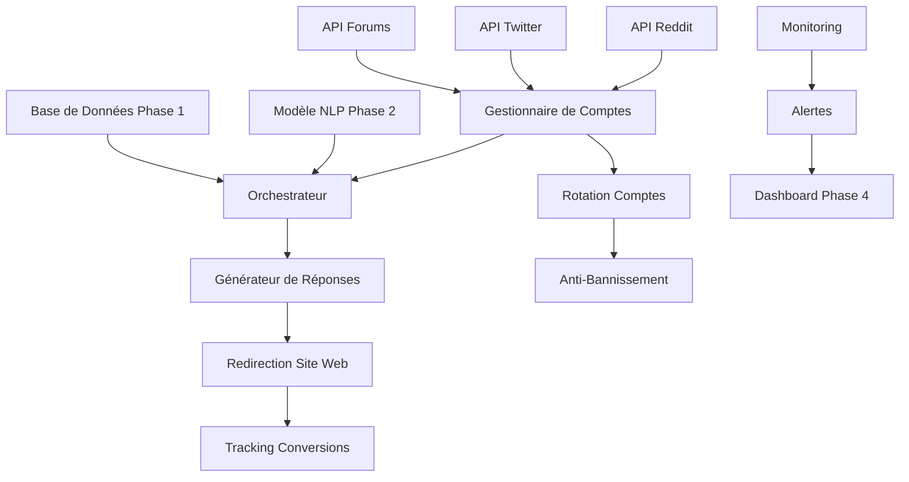

# Grandes Lignes - Phase 3 : Intégration et Automatisation

## 📌 Contexte du projet

L'objectif est de créer un agent conversationnel intelligent qui interagit sur les réseaux sociaux, forums et plateformes web pour engager les utilisateurs suite à leurs messages et les rediriger vers un site spécifique (ex: TheKnowHow.ae pour les services de second opinion médicaux).

### L'IA devra :
✔ Analyser des discussions en ligne et détecter des opportunités d'engagement.
✔ Interagir de manière naturelle avec les utilisateurs pour les convaincre.
✔ Rediriger vers un site web pertinent selon le domaine ciblé.
✔ Offrir un tableau de bord permettant de gérer l'IA et d'analyser les performances.

## 🔗 Dépendances
- Dépend de la Phase 1 :
  - Base de données des conversations
  - Système de détection des opportunités
- Dépend de la Phase 2 :
  - Modèle NLP entraîné
  - Système de génération de réponses
- Les résultats de cette phase seront utilisés par :
  - Phase 4 : Dashboard d'Administration (données d'engagement)
  - Phase 5 : Monétisation (taux de conversion)

## 📊 Métriques de Succès

### Performance Système
- Temps de réponse < 2s
- Disponibilité > 99.99%
- Taux d'erreur < 0.1%

### Engagement
- Taux de réponse > 95%
- Taux de conversion > 30%
- Temps moyen avant conversion < 24h

### Gestion des Comptes
- Rotation automatique des comptes
- Taux de bannissement < 0.1%
- Détection des blocages < 5min

### Intégration
- Support de 5+ plateformes
- Synchronisation temps réel
- Backup automatique des conversations

## 💬 Phase 3 : Intégration et Automatisation

### 📌 Objectif
Faire fonctionner l'IA en temps réel sur les plateformes cibles.

### 🔹 Étape 3.1 : Automatisation des Réponses
- Création de bots automatisés capables de répondre sur Reddit, Twitter, etc.
- Implémentation de restrictions pour éviter les bannissements (ex: fréquence des réponses, rotation de comptes…).

### 🔹 Étape 3.2 : Intégration avec le Site Web
- Ajout d'un chatbot sur le site pour continuer la conversation après redirection.
- Tracking des conversions : Analyser combien d'utilisateurs ont cliqué sur le lien.

### 📌 Sortie attendue
Un système fonctionnel où l'IA engage les utilisateurs et les amène sur le site web.

## 🏗️ Architecture

### Diagramme d'Architecture

### Composants Principaux
1. **Gestionnaire de Comptes**
   - Rotation automatique
   - Gestion des quotas
   - Détection des blocages

2. **Orchestrateur**
   - Coordination des réponses
   - Gestion des priorités
   - Logique de redirection

3. **Système Anti-Bannissement**
   - Limitation des requêtes
   - Simulation humaine
   - Détection des patterns

4. **Tracking et Analytics**
   - Suivi des conversions
   - Analyse des performances
   - Reporting automatique 