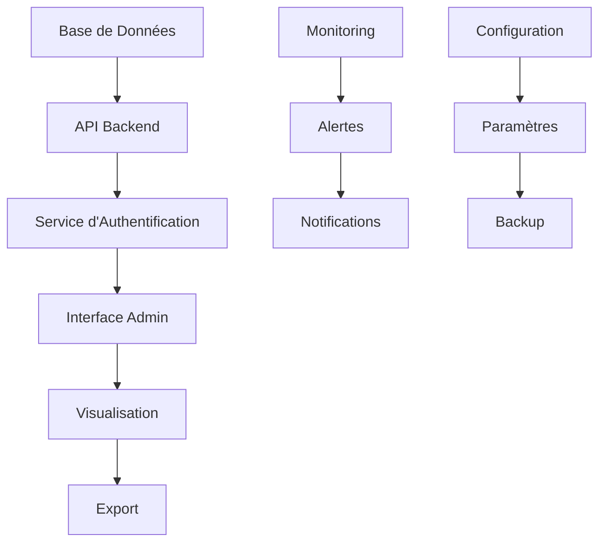

# Grandes Lignes - Phase 4 : Dashboard d'Administration

## 📌 Contexte du projet

L'objectif est de créer un agent conversationnel intelligent qui interagit sur les réseaux sociaux, forums et plateformes web pour engager les utilisateurs suite à leurs messages et les rediriger vers un site spécifique (ex: TheKnowHow.ae pour les services de second opinion médicaux).

### L'IA devra :
✔ Analyser des discussions en ligne et détecter des opportunités d'engagement.
✔ Interagir de manière naturelle avec les utilisateurs pour les convaincre.
✔ Rediriger vers un site web pertinent selon le domaine ciblé.
✔ Offrir un tableau de bord permettant de gérer l'IA et d'analyser les performances.

## 🔗 Dépendances
- Dépend de la Phase 1 :
  - Structure de la base de données
  - Métriques de base
- Dépend de la Phase 2 :
  - Performances du modèle NLP
  - Métriques de qualité des réponses
- Dépend de la Phase 3 :
  - Données d'engagement en temps réel
  - Statistiques de conversion
- Les résultats de cette phase seront utilisés par :
  - Phase 5 : Monétisation (optimisation des performances)

## 📊 Métriques de Succès

### Performance Dashboard
- Temps de chargement < 1s
- Mise à jour en temps réel
- Disponibilité > 99.99%

### Visualisation
- Graphiques interactifs
- Export des données
- Personnalisation des vues

### Monitoring
- Alertes en temps réel
- Détection d'anomalies
- Prédiction des tendances

### Administration
- Gestion multi-utilisateurs
- Logs d'audit complets
- Backup automatique

## 🏗️ Architecture

### Diagramme d'Architecture

### Composants Principaux
1. **Interface d'Administration**
   - Dashboard principal
   - Gestion des utilisateurs
   - Configuration du système

2. **Système de Monitoring**
   - Collecte des métriques
   - Génération d'alertes
   - Historique des performances

3. **Service de Visualisation**
   - Graphiques interactifs
   - Tableaux de bord personnalisables
   - Export des données

4. **Gestion des Accès**
   - Authentification
   - Contrôle des permissions
   - Journal d'audit

5. **Système de Backup**
   - Sauvegarde automatique
   - Restauration des données
   - Historique des configurations

## 📊 Phase 4 : Dashboard d'Administration

### 📌 Objectif
Offrir un outil de gestion et d'analyse des performances de l'IA.

### 🔹 Étape 4.1 : Interface Utilisateur (UX/UI)
- Statistiques sur les conversations (nombre d'engagements, taux de conversion…).
- Gestion des comptes de l'IA (ex: gestion des comptes Reddit).

### 🔹 Étape 4.2 : Système de Suivi et Optimisation
- Amélioration continue des réponses selon les performances.
- Détection des blocages (si un compte est suspendu, etc.).

### 📌 Sortie attendue
Un dashboard interactif permettant de superviser et d'optimiser le système. 

Créer les modules manquants :
Implémenter tous les modules référencés dans run_phase2.py
Configurer correctement les modèles NLP
Mettre en place le système de fine-tuning
Préparer les données :
Créer un dataset d'entraînement
Connecter avec les données de la phase 1
Préparer des données de test
Configurer l'environnement :
Mettre à jour config.py
Définir les paramètres d'entraînement
Configurer les chemins d'accès
Ajouter les tests :
Créer des tests unitaires
Implémenter des tests d'intégration
Mettre en place un système de validation