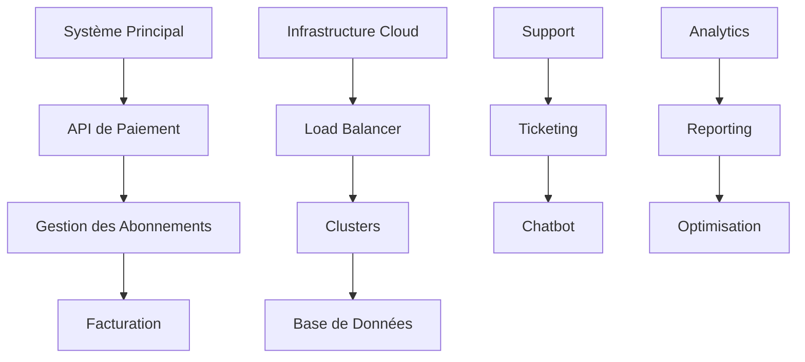

# Grandes Lignes - Phase 5 : Monétisation et Déploiement

## 📌 Contexte du projet

L'objectif est de mettre en place les stratégies de monétisation et d'assurer le déploiement à grande échelle du système.

### La phase 5 devra :
✔ Implémenter les modèles de revenus
✔ Optimiser les coûts d'infrastructure
✔ Assurer la scalabilité du système
✔ Mettre en place le support client

## 🔗 Dépendances
- Phase 1 : Base de données des conversations
- Phase 2 : Moteur NLP fonctionnel
- Phase 3 : Système d'interaction automatisé
- Phase 4 : Dashboard d'administration

## 📊 Métriques de Succès

### Performance Financière
- ROI > 200%
- Coût d'acquisition client < 50$
- MRR > 10 000$

### Scalabilité
- Support de 100 000+ utilisateurs
- Temps de réponse < 2s
- Disponibilité > 99.99%

### Satisfaction Client
- NPS > 8/10
- Taux de rétention > 80%
- Temps de résolution des tickets < 24h

### Croissance
- Taux de conversion > 5%
- Taux de croissance mensuel > 20%
- Taux de churn < 5%

## 🏗️ Architecture

### Diagramme d'Architecture

### Composants Principaux
1. **Système de Paiement**
   - Gestion des abonnements
   - Facturation automatisée
   - Rapports financiers

2. **Infrastructure Cloud**
   - Load balancing
   - Auto-scaling
   - Monitoring des performances

3. **Support Client**
   - Système de ticketing
   - Chatbot d'assistance
   - Base de connaissances

4. **Analytics**
   - Tracking des conversions
   - Analyse des revenus
   - Optimisation des coûts

5. **Sécurité**
   - Protection des données
   - Conformité RGPD
   - Audit de sécurité

## 💰 Phase 5 : Monétisation et Déploiement

### 📌 Objectif
Générer des revenus avec le système.

### 🔹 Étape 5.1 : Modèles de Monétisation
- Abonnement SaaS : Facturer des entreprises pour utiliser l'IA.
- Lead Generation : Être payé pour chaque utilisateur redirigé.
- Vente de données : Analyse des tendances du marché.

### 🔹 Étape 5.2 : Déploiement et Scalabilité
- Hébergement cloud (AWS, GCP, Azure).
- Gestion des coûts et optimisation des ressources.

### 📌 Sortie attendue
Un produit commercialisable et évolutif.

